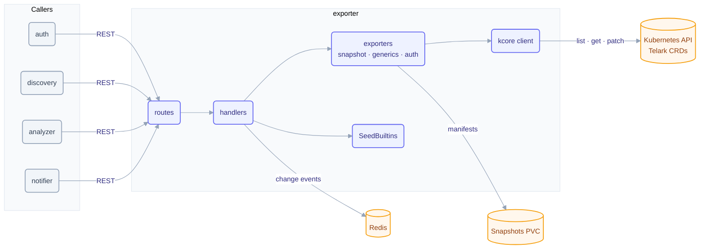

# exporter service

The exporter is Telark's system of record. It owns every Telark custom resource, seeds the
built-in roles, categories and `TelarkConfig`, stores application snapshots and protection plan
reports on its volumes, and serves the REST API the other services use to read and write them.
It is the only stateful service and the only writer of Telark CRs (discovery also patches
`applications/status`).

## Architecture



## Responsibilities

- Own the Telark CRDs (group `telark.io`, see [CRDS.md](../../docs/CRDS.md)) and the OIDC trust Secret: the exporter is the single service that reads and writes them on the cluster. Reads return a view with `id` = `metadata.name` and `.status` flattened into the top level; writes strip `id` and send status fields to the `/status` subresource of `Application`, `ProtectionPlan` and `TelarkConfig`.
- Seed built-in resources (access roles, categories, the `TelarkConfig` named `default`) on startup.
- Migrate stored data at startup, before it serves: run the numbered steps not yet recorded in `TelarkConfig`'s status, lower the record after a rollback of one release, and refuse to start on data two or more releases newer ([Migrations](../../docs/CRDS.md#migrations)).
- Pin the **bootstrap account** in `TelarkConfig` `status.bootstrap` at its first passkey, and at each start pin the enrolled one if none is; then only one account keeps `spec.bootstrap`. Once pinned, a service create or patch that marks another account or unmarks the pinned one answers 409. Break-glass **requests** (`bootstrap/requests`, open, approve, cancel, complete; Internal only) live in that status, written with a compare-and-swap on its `resourceVersion`; `GET bootstrap` serves it to Admins on `ALL`, with `notifyAdmins` (`spec.breakGlassAlerts`, missing reads as on); while that is off, only the pinned account and services get the requests. A recovery can't be approved (409), and only the 72 hours with no sign-in make it eligible. Its completion goes link first, wipe after: on an eligible recovery, `complete` with no body field ends the account's sessions only, and `revoke` (break-glass's last pass before its link) also deletes the passkeys saved after the 72-hour mark, unless no other would remain; neither changes the request. `keep`, the credential id the link registered (a passkey of the pinned account saved after the mark, else 409), deletes every session, every passkey identity but that one and, last, every other passkey, empties the cached passkey and session lists (auth reads passkeys with `Cache-Control: no-cache` anyway), and only then marks the request completed, even if a sign-in landed meanwhile: open, cancel and complete run one at a time (one exporter replica). A `keep` refused because the recovery was canceled deletes that one passkey. A recovery that ends without completing (a sign-in, a deny, or the expiry recorded at a later open) deletes the passkeys saved after its mark, unless no other would remain, before it writes the end, and again after, and a completed one re-issues nothing. The mark is compared with the `creationTimestamp` in the `Passkey` spec, which a restore keeps, and a stamp that doesn't parse is never after it. A completed replacement moves the marker and the pin, and re-issues for 24 hours while its account has no passkey. The pinned account, and every active Admin on `ALL` while `notifyAdmins` is on, are notified of each opened and canceled request; a link break-glass is issuing (a recovery's or a re-issue, notified before it prints) and a completed request reach those Admins whatever `notifyAdmins` says. Each request change is one INFO log line (id, kind, new state, cause). Each status write is one compare-and-swap patch, and five lost in a row answer 409 ([Recovery requests](../../docs/INSTALL.md#recovery-requests)).
- Store and serve **snapshots** of workload manifests (audit, comparison, rollback targets) on a PersistentVolume.
- Store and serve **protection plan reports** (rendered by discovery) and each plan's report ledger on a second PersistentVolume. A reports GC goroutine (own Redis lock key, one replica per tick, shares `SNAPSHOT_GC_INTERVAL_SEC`) sweeps report directories whose plan CR is gone; reports a plan delete kept are outside its reach until a user deletes them.
- Expose the REST surface every other service uses for CRD operations. At most 10 CRD creates run at once: a create that waits 20 seconds for its turn, or whose caller gives up first, answers 503 and creates nothing.
- Store per-user in-app notifications in Redis. Every write that changes a user's list also adds that user's id to the capped stream `notif:changed`; each replica's hub reads it (one `XREAD` loop) and wakes that user's open streams (`GET notifications/events`, 8 per user, then 429). The first copy of a webhook event type, written or merged into an unread one, is queued once per 10 minutes on `notif:events` for the notifier, signed with the service token ([Webhooks](../../docs/INSTALL.md#webhooks)).
- **Ops subcommand:** `migrate-storage <from> <to> [<from> <to>...]` copies each directory tree into the other (the newer copy of a file wins; temp files and `lost+found` are skipped). The chart runs it as an init container when the snapshot and report volumes move to another storage class ([Exporter storage](../../docs/INSTALL.md#exporter-storage)).

## Layout

| Package | Role |
|---|---|
| `internal/routes` | HTTP route registration (rest router) |
| `internal/handlers/{resources,config,categories,plans,auth,notifications}` | Request handlers per CRD domain |
| `internal/exporters/{snapshot,generics,auth,shared}` | CRD read/write + snapshot serialization against the cluster |
| `internal/exporters/reports` · `internal/handlers/reports` | Report create/list/download/delete, kept reports, ledger get/put, reports orphan sweep |
| `internal/utils/artifact` | Generic on-volume primitives shared by snapshots and reports: atomic write, path containment, `TickAllowed` (Redis-gated GC tick) |
| `internal/utils/reports` | Reports store on the reports volume (per-plan directory, ledger, retention of 10 on-demand and 100 window reports, kept reports of deleted plans) |
| `internal/startup` | `SeedTelarkConfig`, `SeedBuiltins` and boot wiring |
| `internal/migrations` | Startup data migrations (`Steps`, `Run`) and the downgrade guard |
| `internal/bootstrap` · `internal/handlers/bootstrap` | The bootstrap pin, the one-marker rule and break-glass requests |
| `internal/managers/envs` | Env resolution |
| `internal/redis/notifications` | Per-user in-app notifications, the change stream hub and the webhook event queue |
| `internal/cache` · `internal/utils/*` | Compute, concurrency, snapshot helpers |
| `internal/authz` | Per-route authorization requirements |

## Dependencies

- **Shared packages:** `data` (CRD types), `kcore` (dynamic informers / client), `rest` (router + server), `x-ware` (Redis, authz, CORS).
- **Infrastructure:** Kubernetes API (CRD storage), the snapshot and report **PVCs**, Redis.
- **Peers:** none upstream; exporter is the backend the other services depend on.

## Configuration

Full reference: [chart README](../../charts/telark/README.md#servicesexporterenv). Key vars:

| Variable | Default | Description |
|---|---|---|
| `SNAPSHOTS_PATH` | `/snapshots` | Mount path for snapshot files |
| `SNAPSHOTS_PVC_NAME` | `<app.name>-exporter-snapshots-pvc` | PVC backing snapshot storage; the chart adds a storage suffix after a class change |
| `SNAPSHOTS_PVC_NAMESPACE` | `<app.namespace>` | Namespace of the PVC |
| `REPORTS_PATH` | `/reports` | Mount path for protection plan report files (the reports PVC) |
| `SNAPSHOT_GC_INTERVAL_SEC` | `3600` | Snapshot sweep interval; also drives the reports orphan sweep (`0` disables both) |
| `EXPORTER_K8S_CLIENT_QPS` / `_BURST` | `50` / `100` | K8s client rate limits, sized for CRD-write fan-out |
| `EXPORTER_LIST_RENDER_CONCURRENCY` | `2` | List renders at once per list route; requests for the same list share one render |
| `OIDC_TRUST_SECRET_NAME` | `telark-oidc-trust-secret` | Secret whose `googleJwkJson` key holds the Google JWK set (chart: `app.auth.oidc.existingSecret` or the chart-managed one) |

## API

REST under `/api/v1/`, one collection per resource with HTTP verbs (no `/get`, `/patch` suffixes):
`applications`, `users`, `groups`, `accessroles`, `config`, `categories` (`?scope=` filters),
`protectionplans`, `reports`, `snapshots`, `notifications` and `auth/sessions`. Service-only routes
live under `internal/` (`internal/users/by-{username,email,identity}`, `internal/reports`,
`internal/protectionplans/{id}/ledger`, `internal/snapshots`, `internal/notifications`,
`internal/auth/users/{userId}/sessions`, `internal/auth/passkeys`), and cleanup views and
finalizers under `cleanup/{type}` (`{type}` is `users`, `groups` or `accessroles`; finalizer writes are
service-only).
`auth/sessions/self` (GET, PATCH internal, DELETE) is the session named by `X-Session-Token` (a raw
token, which x-ware takes from the dashboard's cookie, or a session name from a peer); `GET` answers its
`metadata.name`, which tells the dashboard which listed device it is; `DELETE auth/sessions/{name}` revokes another of the
caller's own sessions and answers 404 for anyone else's.
`GET notifications/events` is a server-sent event stream of the caller's own list: `: connected` at once, `event: changed`
(`data: {}`) after a change, on which the client refetches, and `: ping` every 15 s. It re-checks the session every 60 s
and ends on a revocation, expiry or suspension, never on an outage; a peer with the service token gets 403.
Liveness/readiness at `/api/v1/status/{live,ready}`.

Role create and patch (`POST accessroles`, `PATCH accessroles/{id}`) answer 400, naming the rule, when a
`scopesAndPermissions` entry lists a deny rule that isn't `<scope>.<action>.deny` for the entry's scope (an `ALL`
entry takes any scope's rule), with the actions of `DenyableActions` in `internal/data/resources/role/rules.go`.
A patch without `scopesAndPermissions` leaves the stored rules unchecked.

Protection plan create and patch refuse (403) lifecycle, approval and material keys from
sessions, so approval (`pending_approval`) and phase changes stay on discovery's gated routes.
Only Internal callers (discovery) write `approvalMode`, `approval`, `phase`, `renderedPolicies`,
`startedAt`, `startedBy`, `terminatedAt`, `terminatedBy`, `reason`, `health`, `healthCheckedAt`,
`healthDetail`, `window`, `policies`, `scope` (including its nested `exclusions`), `mode`, `timeMode`,
`timeRange`, `repeat` and `name` (renames go through discovery's `revise`, which keeps names unique).

Protection plan routes (`{id}` = plan name). Deny rules are `protection-plans.<action>.deny`
entries a custom role lists; built-in roles list none.

| Route | Authz | Purpose |
|---|---|---|
| `GET protectionplans` | Read, deny `viewprotectionplans` | List plans |
| `GET protectionplans/{id}` | Read, deny `viewprotectionplans` | Read one plan |
| `POST protectionplans` | Write, deny `createprotectionplan` | Create (discovery; sessions cannot send lifecycle or material keys) |
| `PATCH protectionplans/{id}` | Internal | Patch the CR; users edit through discovery, which owns the lifecycle |
| `DELETE protectionplans/{id}?keepReports=` | Internal | Delete the CR; users delete through discovery's `clear`, which removes deployed policies first. Its reports go with it unless `keepReports=true` |

Protection plan reports (`{id}` = plan name):

| Route | Authz | Purpose |
|---|---|---|
| `POST internal/reports` | Internal | Store a rendered report (called by discovery) |
| `PUT internal/protectionplans/{id}/ledger` | Internal | Replace the plan's report ledger |
| `GET internal/protectionplans/{id}/ledger` | Internal | Read the plan's report ledger |
| `GET reports?planId=&trigger=&from=&to=&limit=` | Read (protection plans), deny `viewprotectionplanreports` | List report metadata across all plans, newest first. Optional filters: `planId` (repeatable or comma list), `trigger` (`manual`, `cancel`, `end`, `window`), `from`/`to` (RFC3339, on `generatedAt`). `limit` defaults to 200, max 1000; `X-Total-Count` holds the match count before the limit |
| `GET protectionplans/{id}/reports` | Read (protection plans), deny `viewprotectionplanreports` | List the plan's reports |
| `GET protectionplans/{id}/reports/download?report=&format=` | Read (protection plans), deny `downloadprotectionplanreport` | Download one report as `html`, `md`, `json` or `csv` |
| `DELETE protectionplans/{id}/reports?report=` | Owner (protection plans), deny `deleteprotectionplan` | Delete one report, of a live plan or a kept one. Deleting a plan deletes its reports, so the plan delete's rule gates it |
| `GET reports/kept` | Read (protection plans), deny `viewprotectionplanreports` | List the reports plan deletes kept, one entry per deleted plan with its name |

Downloads carry `X-Content-Type-Options: nosniff` and `Content-Security-Policy: sandbox`, and are served inline (no `Content-Disposition`). Reports are removed when their plan is deleted, unless the delete keeps them: `keepReports=true` moves the plan's directory from `plans/` to `kept/` on the reports volume (with a `plan.json` holding the plan's name, and without the ledger), where no sweep looks. The download and delete routes serve kept reports too, and a kept plan's last deleted report removes its directory. A report is a single file, so a delete leaves nothing behind in any listing.

Environment, tag and kind categories (`plan-environments`, `plan-tags`, `plan-kinds`) follow the `protection-plans`
scope: create needs Contributor (deny `addprotectionplancategory`), edit and delete need Owner
(deny `editprotectionplancategory` / `deleteprotectionplancategory`). For every category scope,
built-in categories cannot be patched or deleted and `type: built-in` cannot be set (400); a name
already used in the scope, compared trimmed and case-insensitively, is refused (409).

Applications and snapshots: `POST applications`, `DELETE applications/{name}`,
`POST internal/snapshots` and `DELETE snapshots/{id}` are Internal (the notifier and discovery; users
delete an application through discovery's `reset`, which also purges its Redis state). On
`PATCH applications/{name}`, sessions may set only `displayName` (at most 200 characters) and
`description` (at most 1000): any other spec key answers 403 and an over-long value 400. Internal callers
keep full access.

Config (`PATCH config`, the `TelarkConfig` named `default`) is checked per field: `excludedNamespaces`
needs settings Contributor (deny `editdiscoveryconfig`), `snapshots` Contributor
(deny `editsnapshotstorage`), `ai` Owner (deny `controlainsights`); `oidc`, `selfRegistration` and `breakGlassAlerts` are Internal
(auth is their single writer and lets only the bootstrap account change them, so every session gets 403),
and so is `cluster` (written by discovery, stored in `.status`). `GET config` shows all of them to settings
readers. `oidc.googleJwkJson` is written to the
Secret `telark-oidc-trust-secret` (or `app.auth.oidc.existingSecret`), not the CR, and `GET config` merges it
back. A patch naming none of these fields needs settings ReadOnly, like `GET config`, since it answers
with the whole config. A value the CRD schema rejects answers 400 naming the field, for example `spec.ai.model`.

Users, groups and access roles: creating a user with roles, groups or a status applies the same rules as
patching them (users Owner + `attachroletouser`, groups Owner + `addusertogroup`, users Admin +
`suspenduser`); attaching or removing a group's roles needs groups Owner plus `attachroletogroup` /
`removerolefromgroup` (a group create carrying roles is gated like an attach); a role create or patch may not grant a scope level above the caller's own on that
scope (an `ALL` grant counts for every scope). The same cap applies to assigning a role: a user or group create or
patch answers 403 naming the role and scope when a role being added grants a level above the caller's own
(deny rules on that role do not count; roles already held are not checked). Taking a role away is
capped the same way: removing it from a user, detaching it from a group, and deleting it or a group
carrying it. Adding or removing a group member, from either side, is capped by every
role the group carries. A role patch touching `status`, `validity` or `scopesAndPermissions` is capped
against the stored and the merged role. Role protection flags answer 403: `preventModification`
refuses any patch beyond `protection`, and `preventScopeChanges`, `lockName` and `lockCategory` refuse a
change to `scopesAndPermissions`, `name` and `categoryRef`, unless the same patch lifts that flag. Sessions may not set `type: built-in` or change a built-in role's
`protection` (403); a custom role's `protection` is set by its creator at create and changed afterwards
only by its creator or an Admin on ALL (403 otherwise). A role created without `type` is `custom`.
`createdBy` and `lastUpdatedBy` of roles and groups are stamped from the caller; body values are
ignored. Deleting a role with `protection.softDelete` keeps it with `status: Deleted` and `deletedAt`,
so it grants nothing; `preventDeletion` refuses the delete (403). Deny rules are stored lower-cased. `identities` on a user is Internal only, and `email` / `username` are changed
only by the account owner (403 otherwise; resending the stored value is allowed). A user's `email` is
unique like the username (case-insensitive, trimmed): a duplicate answers 409. `status.invite`
(auth's record of a pending enrollment link) and `status.inviteAcceptedAt` (when a passkey closed one)
are reserved like `bootstrap`: a session create or patch carrying either, even as `null`, answers 403.
Internal callers are exempt.

Request bodies on the user, group, role, category and protection-plan create and patch routes must use
the exact JSON field names: an unknown or differently cased key (`RoleRefs`, `status.Phase`)
answers 400 before any guard or write runs. A user patch whose `status` omits `phase` (auth's
last-login stamp and invite) keeps the stored phase.

Roles and groups on a user are diffed against the stored lists: an addition needs `attachroletouser` /
`addusertogroup`, a removal `removerolefromuser` / `removeuserfromgroup`, each with users or groups Owner.
A group's `userRefs` is gated the same way (groups Owner plus the add or remove rule, never on
oneself). Ids that do not resolve to a live user, group or role answer 400 naming them, and lists are
deduplicated on write.

Group membership is stored on both sides, and grants read only the user side, so the exporter keeps them
consistent: a group create or patch that changes `userRefs` updates each affected user's
`groupRefs`, and a user create or patch that changes `groupRefs` updates each group's
member list. The counterparts are written first, one at a time under their own lock, and the caller's
own record last; a failure answers 500 with the record that could not be updated and the caller's
record unchanged, so the same request can be retried (every mirror write is a no-op once applied).
A user or group delete strips the deleted record from the other side right after the delete; if
that write fails, auth's cleanup sweep, which holds the finalizer, removes it.
Affected users' cached grants are dropped. On boot, one pass over all users and groups aligns the
group side to the user side, which is what grants: a group gains the users that name it and loses the
ones that don't, and user lists lose duplicates and groups that no longer exist. Nobody's access changes.

Deleting a user (`DELETE users/{id}`) purges the user's sessions at once and, while the
cleanup finalizer still holds the record, the user grants nothing and `GET users/{id}` answers
410, so peers resolving grants over HTTP deny as well. A user, group or role whose `deletionTimestamp`
is set grants nothing anywhere (`deletionTimestamp` is projected into the typed reads and the GET
responses) and refuses every PATCH from a session with 410; the cleanup cascade (service token) still
patches it. Finalizer removal and cleanup views of a record that is already gone answer 404.

Administrators (Admin on `ALL` through an active role, directly or via a live group) and bootstrap
accounts (`spec.bootstrap: true`, written only with the service token and, once one is pinned, only by a
completed replacement; a session sending the field gets 403) are hidden from every caller who is not an administrator or a service: the users list omits them,
`GET` by id, username, email or identity answers 404, group member lists and cleanup views omit their
ids. A group patch keeps the hidden members, and naming one answers 400 like an unknown id; a user
patch of one answers 404 before its body is read. Such callers share one cached, coalesced users list and one
groups list (`RestrictedListKey`, keyed also by the users, groups and roles list generations); their single-record
GETs stay uncached. `GET users/names?ids=a,b` is the one exception to the hiding: any signed-in caller
gets id → username for up to 100 ids (unknown ids left out), administrators included, so audit fields
name their actors. Any signed-in caller also reads their own record (`GET users/{id}`) without the users
scope; anyone else's needs ReadOnly on `users`, and a missing id answers the same 403. Bootstrap accounts cannot be
deleted through the API, only they may edit their own record (any other caller gets 403, a group
create or patch adding or removing one included), and a session
may not create a user with the `BOOTSTRAP_ADMIN` email, move another account onto it, or move the
bootstrap account off it (403); an unchanged email is always accepted. Any Admin on `ALL` may delete or
suspend another administrator, but a user delete, suspension or `roleRefs`/`groupRefs` change, and a
group delete, `roleRefs` change or member removal, that would leave no active user holding Admin on
`ALL` answers 409, whoever calls. Nobody may delete their own account (403).

Snapshot reads (`GET snapshots/{id}` and `/manifest`) mask every `Secret` `data` and `stringData`
value with `[redacted]` for session callers; the stored file and Internal callers (the rollback
controller) keep the real values. Both routes are withheld by `viewapplicationssnapshots` and by
`viewapplicationsnapshotmanifest`.

## Build & run

```sh
# from the repo root: the image builds the service together with internal/
go build ./services/exporter
docker build -f services/exporter/Dockerfile -t ghcr.io/telark/exporter:<version> .
```

Runs in-cluster via the [telark chart](../../charts/telark); see [INSTALL](../../docs/INSTALL.md)
and [CONTRIBUTING](../../CONTRIBUTING.md).
