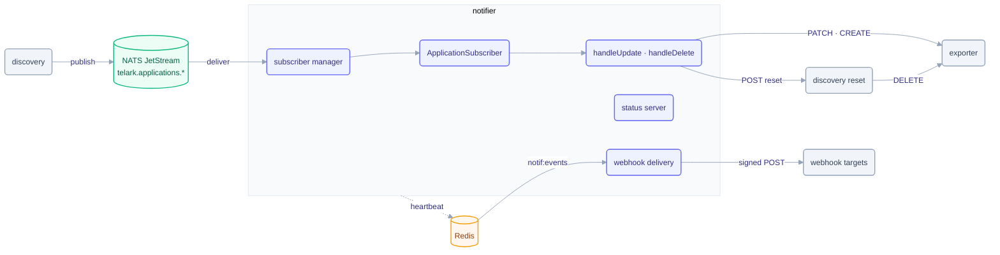

# notifier service

The notifier service keeps the `Application` CRs in step with what discovery sees. It consumes
the `telark.applications.update` events discovery publishes on NATS JetStream and upserts the
`Application` CR (`applications.telark.io`) through exporter's REST API. A `telark.applications.delete` message (nothing publishes one) calls
discovery's application reset, which clears the app's Redis state and deletes the CR and its
snapshot files through exporter. Discovery only publishes and exporter does the writes, so application identity stays
consistent under load.

It also delivers webhooks: the events the exporter queues on the Redis stream `notif:events` go, signed, to the
targets in `app.webhooks` ([Webhooks](../../docs/INSTALL.md#webhooks)). The notifier sends them because it mounts no
Kubernetes token, so a bug in that egress path can't reach the API.

## Architecture



## Responsibilities

- Subscribe to the `telark.applications.*` JetStream (creates the streams on start).
- On **update**: patch the named `Application` via exporter (`PATCH applications/{name}`); on `404`, create it (`POST applications`, upsert).
- On **delete**: reset the named application via discovery (`POST /api/v1/applications/{name}/reset`, authenticated with the service token). `200` and `404` (already gone) ack; a status the reset may later succeed on (`5xx`, `409`, no answer) is NAK'd for redelivery; any other refusal is acked and logged.
- Ack with structured logging; malformed messages are acked and logged, not redelivered forever.
- Expose a minimal HTTP status server whose readiness reflects live NATS connectivity.
- Deliver webhooks: one consumer group per target on `notif:events`, created after the newest entry so a new target gets
  no backlog; entries that don't verify against the service token are dropped; Standard Webhooks signatures; 8 attempts over about 8 h, each owed delivery pending in Redis so it survives
  a restart; the dialed address checked against loopback, link-local and, without `allowPrivate`, private ranges. The
  targets file is re-read every 30 s, and one bad target refuses the whole file.

## Layout

| Package | Role |
|---|---|
| `internal/subscribers/manager` | Creates streams, starts/stops subscribers, tracks connectivity |
| `internal/subscribers/applications` | The application subscriber: update/delete/unknown handlers |
| `internal/subscribers/base` | Shared subscribe/ack/execute lifecycle helpers |
| `internal/status` | Minimal HTTP status server (liveness/readiness probes) |
| `internal/webhooks` | Webhook targets (loading, validation), the delivery loop per target, signing, retries and the address guard |
| `internal/constants` | Config keys, log/message strings |

## Dependencies

- **Shared packages:** `data` (Application types, messages), `rest` (applications client for exporter and discovery, router, server), `x-ware` (NATS core/streams, Redis).
- **Infrastructure:** NATS JetStream (subscribe), Redis (connectivity heartbeat, the `notif:events` stream and its
  consumer groups `webhook:<name>`, and `webhook:retry-after:*` keys), egress to the webhook targets.
- **Peers:** publishes nothing; consumes from **discovery** (via NATS) and the **exporter**'s `notif:events` stream (via Redis), writes through **exporter** and resets deleted applications through **discovery** (via REST). No `kcore`: notifier never touches the K8s API directly.

## Configuration

Full reference: [chart README](../../charts/telark/README.md#servicesnotifierenv). Its
service-specific variables are `NOTIFIER_APPLY_WORKERS` (default `8`), the concurrent apply workers (an
application always maps to the same worker, so its updates stay ordered), and `WEBHOOK_TARGETS_FILE`, where the
mounted `app.webhooks` Secret is read. It inherits `app.shared.redis` and, when
`useNatsCreds: true`, the NATS consumer credentials from `<app.name>-nats-consumer-secret` (`NATS_USER` / `NATS_PASSWORD`).

## API

No REST business API. The status server serves `/api/v1/status/{live,ready}`; readiness
returns healthy only while the NATS subscriber is connected.

## Build & run

```sh
# from the repo root: the image builds the service together with internal/
go build ./services/notifier
docker build -f services/notifier/Dockerfile -t ghcr.io/telark/notifier:<version> .
```

Runs in-cluster via the [telark chart](../../charts/telark); see [INSTALL](../../docs/INSTALL.md)
and [CONTRIBUTING](../../CONTRIBUTING.md).
